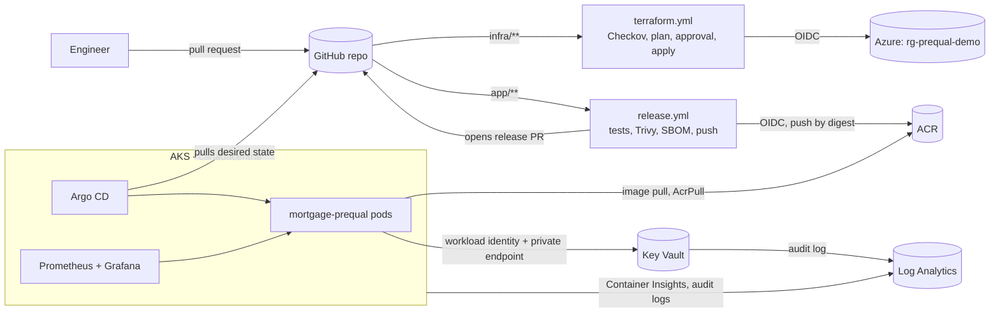

# Broker Mortgage Pre-Qualification Platform

A small, bank-grade delivery platform on Azure. A Python API that mortgage
brokers call to pre-qualify a borrower (GDS/TDS ratios at the stress-test
rate) is built, scanned and released through GitHub Actions, and deployed to
AKS by Argo CD (GitOps). Every step leaves audit evidence.

The same container serves a one-page broker portal, **Haventree Bank-Interview**,
at `/`. It is a thin client that calls the API with the same key check
(`kubectl -n mortgage-prequal port-forward svc/mortgage-prequal 8000:80`, then
open http://localhost:8000).

> Interview demonstration project. Not affiliated with or endorsed by Haventree Bank.
> The lending rules are simplified and are not any bank's credit policy, and no real customer data is used.

## Architecture



## Tools
| Area | Tool |
|---|---|
| Infrastructure as Code | Terraform (azurerm 4.x), remote state in Azure Storage |
| CI/CD | GitHub Actions with OIDC to Azure (no stored cloud secrets) |
| GitOps / CD | Argo CD (app of apps, self-heal, projects) |
| Containers | Docker, AKS (Azure CNI Overlay + Cilium), ACR |
| DevSecOps | Trivy (image gate + SBOM), Checkov (Terraform, Kubernetes, Dockerfile), Key Vault + CSI driver, Defender for Containers, Pod Security Admission, NetworkPolicy |
| Observability | Prometheus, Grafana, Alertmanager, Azure Monitor (Container Insights, Log Analytics, KQL) |

## Repository layout
```
app/                    Python FastAPI service, broker portal (app/static), tests, Dockerfile
infra/                  Terraform (network, AKS, ACR, Key Vault, monitoring, identities)
deploy/mortgage-prequal Kubernetes manifests (Kustomize) - what Argo CD deploys
argocd/                 Argo CD install values, root app, projects, applications
scripts/                bootstrap + read-only bootstrap check, manifest values, Argo CD install, smoke test, traffic, teardown
docs/                   runbook, RCA template, audit controls
.github/workflows/      terraform.yml, app-ci.yml, release.yml
```

## Release flow
1. Change code in `app/` through a PR. `app-ci` runs tests, the Trivy image scan and the Checkov manifest scan.
2. Merge. `release` builds, scans, generates an SBOM, pushes to ACR by digest and **opens a release PR**.
3. Merge the release PR (= production approval). Argo CD deploys it in about a minute.
4. Rollback = revert the release PR.

See `docs/audit-controls.md` for the control-to-evidence map and `docs/runbook.md` for on-call.
